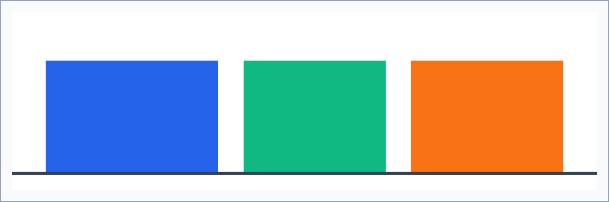
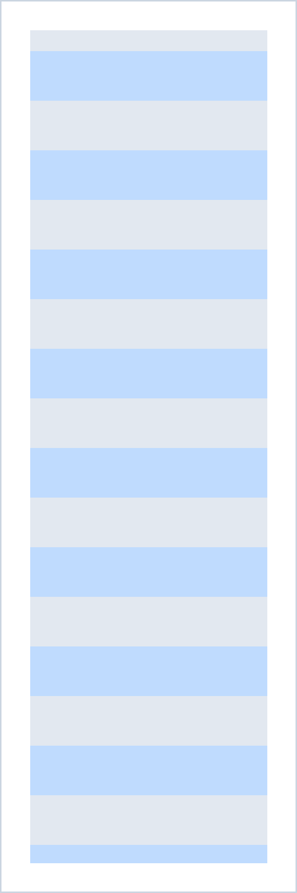
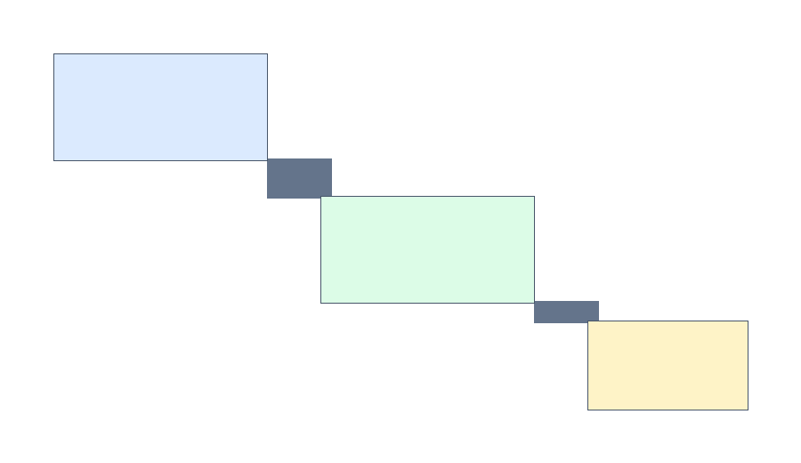

# 图片排版验证

本文档验证三件事：相对路径图片能否解析、过宽图片是否按正文宽度缩放、过高图片是否按页面高度缩放。所有图片均位于与本文件同级的 `assets/` 目录。

## 1. 宽图

宽图为 1200×400 像素，按 96 dpi 换算宽约 31.8 厘米，明显超过 A4 正文宽度，渲染时必须等比缩小到正文宽度以内，且不得变形。

图 1 三个样区的记录数量对比（示例数据）。图注应位于图片下方，与图片左对齐或居中保持一致。

## 2. 高图

高图为 600×1800 像素，按 96 dpi 换算高约 47.6 厘米，超过 A4 页面高度，渲染时必须等比缩小到单页可容纳的高度，不得被裁切为半张。

图 2 竖版生境分区示意。若该图被裁切、跨页断裂或出现只剩顶部的现象，该用例失败。

## 3. 小图

小图为 96×96 像素，渲染时保持原尺寸，不应被强行放大到正文宽度，也不应被压缩成模糊的方块。

图 3 小尺寸图标，用于验证小图不被放大。

## 4. 流程图

流程图为 900×520 像素，宽度略大于正文宽度，应缩放后完整显示，三条连接线不得被裁掉。

图 4 从外业记录到内业提交的流程示意。

## 5. 图文混排说明

图片前后的正文段落应与图片保持一致的段间距，不出现图片紧贴文字、或图片下方出现大段空白的情况。图片若使用相对路径，必须相对于**当前 Markdown 文件所在目录**解析，而不是相对于命令行工作目录解析。
